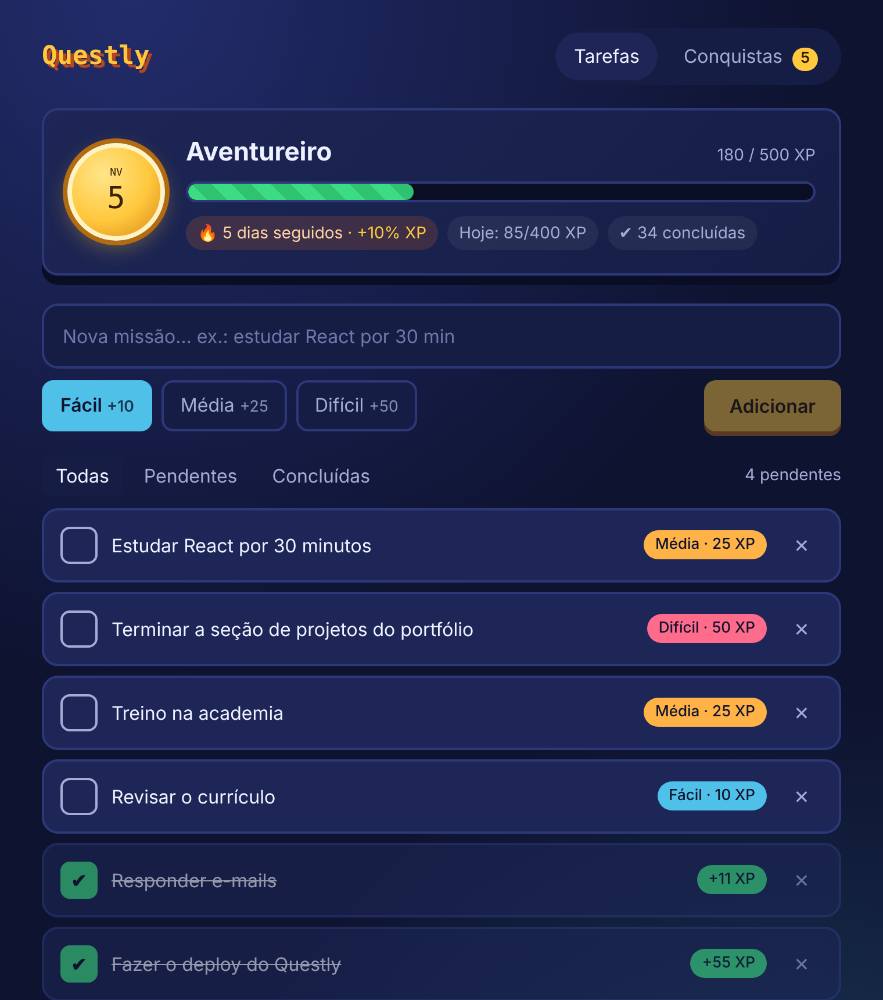

# Questly — lista de tarefas gamificada

**[▶ Acesse o Questly online](https://questly-indol.vercel.app/)**




Lista de tarefas em React + Vite em que cada tarefa concluída vale XP. Você sobe de nível, mantém sequências de dias (streak) e desbloqueia conquistas.

## Como rodar

```bash
npm install
npm run dev
```

Depois abra o endereço que aparecer no terminal (normalmente http://localhost:5173).

Para gerar a versão de produção: `npm run build` (o resultado vai para a pasta `dist/`).

## Regras do jogo

| Dificuldade | XP  |
|-------------|-----|
| Fácil       | 10  |
| Média       | 25  |
| Difícil     | 50  |

- **Níveis:** para sair do nível N para o N+1 são necessários `N × 100` XP.
- **Títulos:** Novato (1), Aprendiz (3), Aventureiro (5), Veterano (8), Mestre (12), Lenda (20).
- **Streak:** dias seguidos com pelo menos uma tarefa concluída. Dá +10% de XP a partir de 3 dias e +25% a partir de 7.
- **Hábitos (tarefas recorrentes):** ao criar, escolha *Uma vez*, *Todo dia* ou *Alguns dias* (dias da semana). Os hábitos do dia aparecem em "Hábitos de hoje" e se renovam à meia-noite. Cada hábito tem a própria sequência (🔥), contada só nos dias programados.
- **Conquistas:** 10 medalhas (primeira tarefa, 10 e 50 tarefas, primeiro hábito, 30 hábitos, 5 difíceis, streaks de 3 e 7 dias, níveis 5 e 10).
- **Limite diário:** no máximo 400 XP por dia (`LIMITE_XP_DIARIO` em `regras.js`). Tarefas concluídas depois disso não dão XP nem contam para conquistas.
- **Desmarcar desfaz tudo:** devolve o XP, desconta do limite do dia, remove conquistas que deixaram de valer e, se era a única tarefa do dia, devolve o streak ao que era antes.
- **Avisos de streak:** o painel avisa quando o streak está em risco (última atividade ontem) e quando foi perdido.
- **Desfazer exclusão:** excluir uma tarefa ou limpar as concluídas mostra um botão "Desfazer" por 6 segundos. Excluir uma tarefa concluída mantém o XP.

Os dados ficam salvos no `localStorage` do navegador. Use **Exportar progresso** para baixar um backup em `.json` e **Importar progresso** para restaurar (em outro navegador ou celular, por exemplo).

## Estrutura

```
src/
├── App.jsx                  # estado principal e lógica de concluir/desmarcar
├── index.css                # estilos (tema RPG)
├── game/regras.js           # XP, níveis, streak e conquistas (sem React)
├── hooks/useLocalStorage.js # useState que salva no navegador
└── components/
    ├── PainelJogador.jsx    # nível, barra de XP e streak
    ├── FormTarefa.jsx       # criar tarefa ou hábito (dificuldade e repetição)
    ├── ListaHabitos.jsx     # "Hábitos de hoje" e "Outros dias"
    ├── ItemHabito.jsx       # um hábito (cumprir hoje, sequência, editar, excluir)
    ├── ListaTarefas.jsx     # filtros e lista
    ├── ItemTarefa.jsx       # uma tarefa (concluir, editar, excluir)
    ├── Conquistas.jsx       # grade de medalhas
    ├── LevelUp.jsx          # modal de subida de nível
    ├── Avisos.jsx           # notificações "+25 XP" (no topo, até 3 por vez)
    ├── Desfazer.jsx         # barra "Tarefa excluída · Desfazer"
    └── BackupProgresso.jsx  # exportar/importar progresso em .json
```

## Ideias para evoluir

- Sons ao concluir tarefas e ao subir de nível
- Missões diárias com XP extra
- Categorias/tags e datas de entrega
- Login e sincronização com Supabase
- Transformar em PWA para instalar no celular
